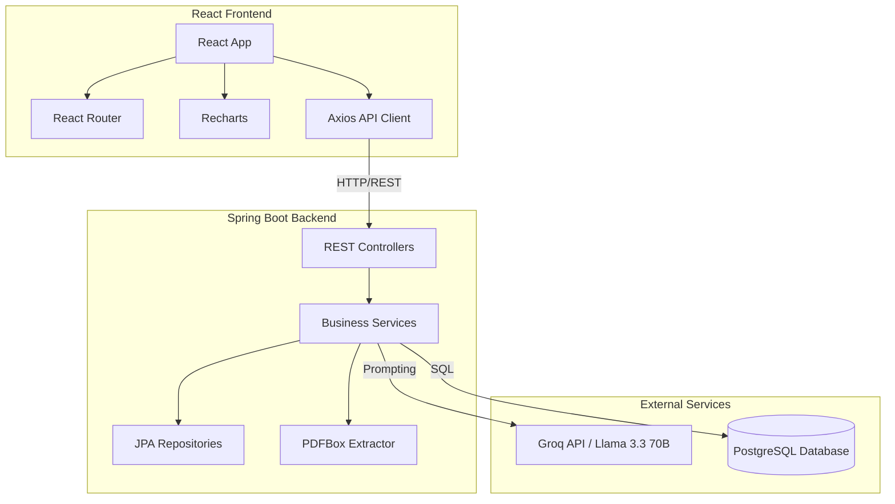
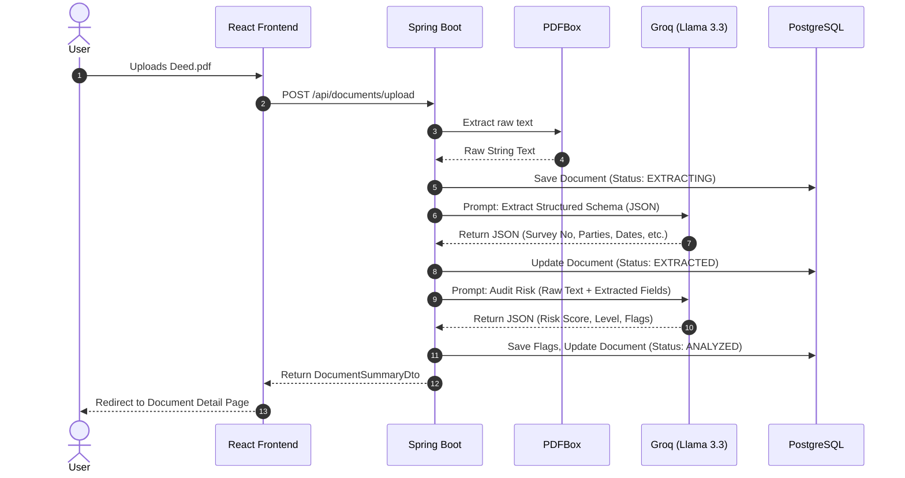

# 🏛️ AI Land Document Analyzer

<div align="center">


**Automated risk auditing, document indexing, and grounded Q&A across your ingested deed archive.**

[Features](#-key-features--deep-dive) • [Architecture](#-system-architecture) • [Tech Stack](#-tech-stack) • [Getting Started](#-getting-started) • [API Reference](#-api-reference)

</div>

---

## 📖 Overview

The **AI Land Document Analyzer** is a full-stack application designed to modernize the way land and property deeds are processed. By leveraging the power of Large Language Models (LLMs) via **Spring AI** and **Groq**, this tool transforms unstructured PDF deeds into structured, searchable, and risk-audited digital records.

The UI features a custom **"Cadastral Ledger"** design system — a deep ink-navy interface that surfaces documents as parchment cards, with risk levels rendered as wax-seal stamps.

---

## 📖 Table of Contents

- [Overview](#-overview)
- [Screenshots](#-screenshots)
- [Key Features & Deep Dive](#-key-features--deep-dive)
- [System Architecture](#-system-architecture)
- [Tech Stack](#-tech-stack)
- [Getting Started](#-getting-started)
- [Environment Variables](#-environment-variables)
- [Project Structure](#-project-structure)
- [API Reference](#-api-reference)
- [Future Improvements](#-future-improvements-production-ready)
- [Contributing](#-contributing)
- [License](#-license)
- [Acknowledgements](#-acknowledgements)

---

## 📸 Screenshots

<div align="center">

  
  <p><em>Main Dashboard — real-time stats and risk distribution</em></p>

  <br/>

  
  <p><em>Deeds Upload — drag-and-drop PDF ingestion pipeline</em></p>

  <br/>

  
  <p><em>Document Ledger — searchable index of all processed deeds</em></p>

</div>

> 💡 **Tip:** Rename your uploaded screenshots to match the paths above (`./images/main-dashboard.png`, etc.), or update the `src` paths to point to your own images.

---

## 🚀 Key Features & Deep Dive

### 1. 📄 Intelligent Ingestion Pipeline

When a PDF is uploaded, the Spring Boot backend extracts raw text using **Apache PDFBox**. This text is passed to the **Llama 3.3 70B** model (hosted on Groq) to extract a highly structured schema — Survey Number, Grantee, Execution Date, Boundaries, and more.

> ⚠️ *Note: The pipeline handles both text-based PDFs and pure image scans (requires an OCR fallback in production).*

### 2. ⚖️ Automated Risk Audit (Title Risk)

Using the extracted schema and the raw text, the LLM acts as a property title auditor. It looks for red flags such as:

- Gaps in the chain of title.
- Encumbrances and pending mortgages.
- Boundary description conflicts.
- Stamp duty inconsistencies.

The model outputs a **Risk Score (0–100)**, a severity level (`LOW`, `MEDIUM`, `HIGH`), and a list of actionable flags with recommendations.

### 3. 💬 Grounded Q&A (RAG-lite)

Users can ask natural language questions about a specific deed. The backend fetches the raw text and forces the LLM to answer **ONLY** using the provided text. If the answer isn't in the document, the AI strictly responds:

> *"The document does not contain enough information to answer this question."*

This prevents legal hallucinations.

---

## 🏗️ System Architecture

The application follows a standard decoupled Client–Server architecture, integrating with an external AI provider.



### Document Processing Flow

Here is exactly what happens under the hood when you upload a deed:



---

## 💻 Tech Stack

### Backend
- **Java 17** / **Spring Boot 3**
- **Spring Data JPA** & **PostgreSQL**
- **Spring AI** — Integration with Groq's OpenAI-compatible API
- **Apache PDFBox** — PDF text extraction
- **Lombok** — Boilerplate reduction

### Frontend
- **React.js (Vite)**
- **React Router** — Navigation
- **Axios** — API requests
- **Recharts** — Risk distribution pie chart
- **Vanilla CSS** — Custom "Cadastral Ledger" design system

### AI Model
- **Llama 3.3 70B Versatile** (via Groq API)

---

## 🛠️ Getting Started

### Prerequisites

- **Java 17+**
- **Node.js 18+**
- **PostgreSQL** (running locally on port `5432`)
- **Groq API Key** — get one for free at [console.groq.com/keys](https://console.groq.com/keys)

### 1. Database Setup

Create a database named `land_analyzer` in your PostgreSQL instance:

```sql
CREATE DATABASE land_analyzer;
```

### 2. Backend Setup

1. Navigate to the backend directory.
2. Update `src/main/resources/application.yml` with your database credentials and Groq API key.

   > **⚠️ SECURITY WARNING:** *Never commit API keys to version control! Use environment variables or a `.env` file.*

3. Run the Spring Boot application:

   ```bash
   ./mvnw spring-boot:run
   ```

   The server will start on **`http://localhost:8080`**.

### 3. Frontend Setup

1. Navigate to the frontend directory.
2. Install dependencies:

   ```bash
   npm install
   ```

3. Start the Vite development server:

   ```bash
   npm run dev
   ```

   The UI will be available at **`http://localhost:5173`** by default (Vite's default port). If you have customized it to `3000` in `vite.config.js`, use that instead — just make sure the Spring Boot CORS configuration allows the same origin.

---

## 🔒 Environment Variables

For a production-safe setup, move all secrets out of `application.yml` and into environment variables.

| Variable | Description |
| --- | --- |
| `SPRING_DATASOURCE_URL` | PostgreSQL JDBC URL |
| `SPRING_DATASOURCE_USERNAME` | PostgreSQL username |
| `SPRING_DATASOURCE_PASSWORD` | PostgreSQL password |
| `GROQ_API_KEY` | Groq API key (server-side only) |
| `APP_CORS_ALLOWED_ORIGINS` | Comma-separated list of allowed frontend origins |

**Example `.env` (backend)**
```properties
SPRING_DATASOURCE_URL=jdbc:postgresql://localhost:5432/land_analyzer
SPRING_DATASOURCE_USERNAME=postgres
SPRING_DATASOURCE_PASSWORD=your_strong_password
GROQ_API_KEY=gsk_your_real_key_here
APP_CORS_ALLOWED_ORIGINS=http://localhost:5173
```

> 🔐 **Never** commit `.env`, real API keys, or DB passwords. Add them to `.gitignore`.

---

## 📁 Project Structure

```
ai-land-document-analyzer/
├── backend/
│   ├── src/main/java/com/example/landanalyzer/
│   │   ├── config/            # CORS, Spring AI, Groq client config
│   │   ├── controller/        # REST controllers
│   │   ├── dto/               # Request / response DTOs
│   │   ├── entity/            # JPA entities (Document, RiskFlag, QnA…)
│   │   ├── exception/         # Global exception handling
│   │   ├── repository/        # Spring Data JPA repositories
│   │   ├── service/           # Ingestion, audit, QnA logic
│   │   │   ├── PdfExtractorService.java
│   │   │   ├── DocumentAnalysisService.java
│   │   │   └── QnAService.java
│   │   └── LandAnalyzerApplication.java
│   ├── src/main/resources/
│   │   └── application.yml
│   └── pom.xml
│
├── frontend/
│   ├── public/
│   ├── src/
│   │   ├── components/        # Reusable UI (ParchmentCard, WaxSeal…)
│   │   ├── pages/             # Dashboard, Upload, Ledger, Detail
│   │   ├── services/          # Axios API client
│   │   ├── styles/            # Cadastral Ledger CSS
│   │   └── main.jsx
│   ├── index.html
│   └── vite.config.js
│
├── images/                    # Screenshots for README
├── .gitignore
└── README.md
```

> 📌 Structure is indicative — package names and file paths may vary.

---

## 📡 API Reference

**Base URL:** `http://localhost:8080`

| Method | Endpoint | Description |
| :--- | :--- | :--- |
| `POST` | `/api/documents/upload` | Uploads a PDF and triggers the sync extraction/audit pipeline. |
| `GET` | `/api/documents` | Retrieves a list of all processed documents. |
| `GET` | `/api/documents/{id}` | Retrieves detailed extracted schema for a document. |
| `GET` | `/api/documents/{id}/risk-flags` | Retrieves the specific risk audit findings. |
| `GET` | `/api/documents/{id}/raw-text` | Returns the raw OCR/PDF extracted text. |
| `DELETE` | `/api/documents/{id}` | Deletes a document and its associated flags/Q&A history. |
| `POST` | `/api/documents/{id}/qna` | Ask a question grounded in the document text. |
| `GET` | `/api/dashboard/stats` | Fetches aggregate stats for the dashboard. |

### Example — Upload a Document

```bash
curl -X POST http://localhost:8080/api/documents/upload \
  -F "file=@deed_of_sale_2023.pdf"
```

```json
{
  "id": 42,
  "fileName": "deed_of_sale_2023.pdf",
  "status": "ANALYZED",
  "surveyNumber": "SN-118/2B",
  "grantee": "R. Meenakshi",
  "executionDate": "2023-08-14",
  "riskScore": 68,
  "riskLevel": "MEDIUM",
  "flagsCount": 3
}
```

### Example — Ask a Question

```bash
curl -X POST http://localhost:8080/api/documents/42/qna \
  -H "Content-Type: application/json" \
  -d '{"question":"Who is the grantee and what is the survey number?"}'
```

```json
{
  "question": "Who is the grantee and what is the survey number?",
  "answer": "The grantee is R. Meenakshi and the survey number is SN-118/2B.",
  "grounded": true
}
```

---

## 🔮 Future Improvements (Production Ready)

- [ ] **Asynchronous Processing:** Move `ingestAndAnalyze` to a queue (RabbitMQ / Kafka) to prevent HTTP timeouts during heavy LLM processing.
- [ ] **OCR Fallback:** Integrate Tesseract or AWS Textract for PDFs that are purely scanned images without a text layer.
- [ ] **Authentication:** Add Spring Security (JWT) to restrict access to sensitive land documents.
- [ ] **Vector Database:** Integrate **pgvector** or **Pinecone** for cross-document semantic search across the entire ledger.
- [ ] **Multi-tenancy:** Support multiple registrars / sub-registrar offices with isolated document vaults.
- [ ] **Audit Trail:** Immutable event log for every extraction, audit, and Q&A interaction.
- [ ] **Unit + Integration tests:** JUnit 5, MockMvc, Testcontainers for PostgreSQL.
- [ ] **Containerization:** Dockerfile + `docker-compose.yml` for one-command local startup.

---

## 🤝 Contributing

Contributions, issues, and feature requests are welcome!

1. Fork the repository.
2. Create your feature branch: `git checkout -b feature/amazing-feature`.
3. Commit your changes: `git commit -m "Add some amazing feature"`.
4. Push to the branch: `git push origin feature/amazing-feature`.
5. Open a Pull Request.

Please make sure to update tests as appropriate and follow the existing code style.

---

## 📄 License

This project is released under the **MIT License**. See the [LICENSE](./LICENSE) file for details.

> If you prefer a different license (e.g., Apache 2.0, GPL-3.0), update this section and add the corresponding `LICENSE` file to the repository root.

---

## 🙏 Acknowledgements

- [Spring AI](https://spring.io/projects/spring-ai)
- [Groq](https://groq.com/)
- [Apache PDFBox](https://pdfbox.apache.org/)
- [React](https://reactjs.org/)
- [Vite](https://vitejs.dev/)
- [Recharts](https://recharts.org/)

---

<div align="center">

**⭐ If you found this project helpful, consider giving it a star!**

<i>Built with ❤️ for modernizing land registry and property title verifications.</i>

</div>
